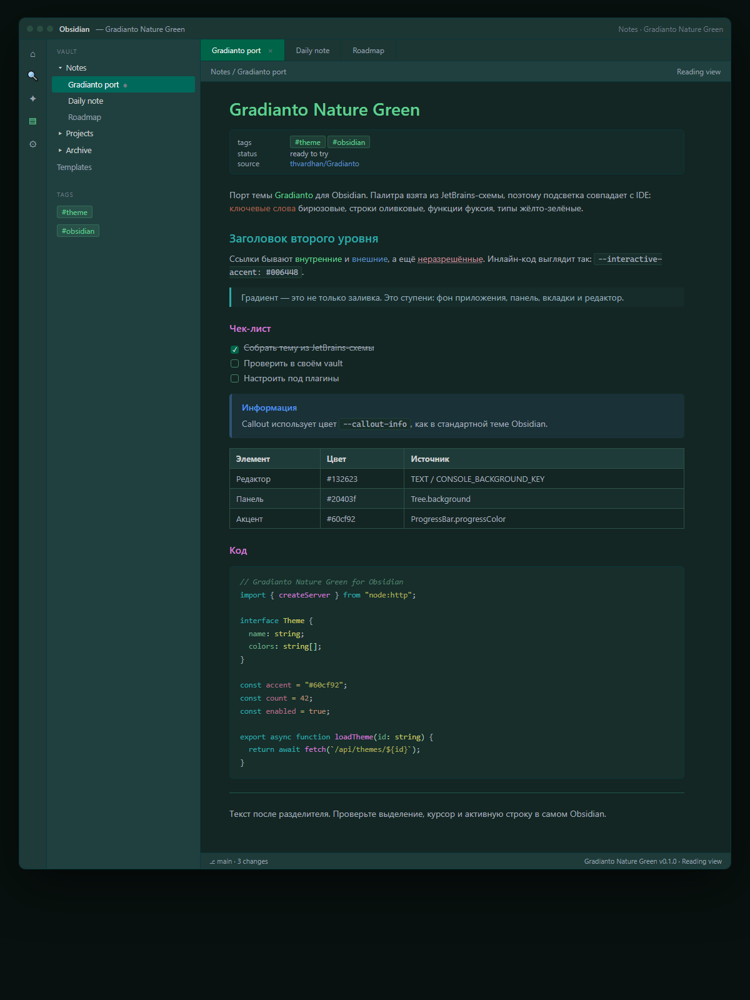

# Gradianto Nature Green для Obsidian

[](https://github.com/Azmandios/obsidian-gradianto/actions/workflows/ci.yml)
[](https://github.com/Azmandios/obsidian-gradianto/releases)
[](./LICENSE)

Порт темы [Gradianto](https://github.com/thvardhan/Gradianto) — победителя
конкурса тем JetBrains 2019 — для [Obsidian](https://obsidian.md). Цвета взяты
из оригинальной JetBrains-схемы, а не подобраны на глаз, поэтому палитра
совпадает с IDEA и с [Zed-портом](https://github.com/Azmandios/zed-gradianto).



## Что внутри

| Параметр | Цвет | Источник в JetBrains-схеме |
|---|---|---|
| Фон редактора | `#132623` | `TEXT.background` / `CONSOLE_BACKGROUND_KEY` |
| Фон панелей | `#20403f` | `ui."*".background`, `Tree.background` |
| Фон вкладок | `#1e3b39` | `EditorTabs.background` |
| Активная вкладка | `#006448` | `EditorTabs.selectedBackground` |
| Выделение | `#00695c` | `selectionBackground` |
| Акцент | `#60cf92` | `ProgressBar.progressColor` |
| Текст | `#a8afbe` | `TEXT.foreground` |
| Ключевые слова | `#2ea9aa` | `DEFAULT_KEYWORD` |
| Строки | `#acac58` | `DEFAULT_STRING` |
| Функции | `#d07bd2` | `DEFAULT_FUNCTION_DECLARATION` |
| Типы | `#c6c666` | `DEFAULT_CLASS_NAME` |
| Комментарии | `#54806d` | `DEFAULT_LINE_COMMENT` |

Тема тёмная. В настройках Obsidian выберите `Appearance → Base color scheme →
Dark`, хотя палитра применяется и в светлом режиме.

## Установка

Тема уже установлена в vault **ObsidianCode**:

```
.obsidian/themes/Gradianto Nature Green/
  manifest.json
  theme.css
```

Откройте Obsidian → `Settings` → `Appearance` → `Themes` и выберите
**Gradianto Nature Green**. Если тема не появилась сразу, перезапустите
Obsidian или переоткройте настройки оформления.

Установить в другой vault:

```powershell
.\install.ps1                                      # vault, открытый в Obsidian
.\install.ps1 -VaultPath "D:\Notes"                # конкретный vault
.\install.ps1 -VaultPath "D:\Notes" -SetTheme      # сразу выбрать тему
```

`-SetTheme` правит `appearance.json`; если Obsidian в этот момент запущен,
он может перезаписать файл при выходе, поэтому надёжнее выбрать тему вручную
в настройках.

Ручная установка: скопируйте `theme.css` и `manifest.json` в
`<vault>/.obsidian/themes/Gradianto Nature Green/`.

Готовый архив можно скачать на странице
[Releases](https://github.com/Azmandios/obsidian-gradianto/releases):
распакуйте папку `Gradianto Nature Green` в `<vault>/.obsidian/themes/`.

## Разработка

```powershell
node scripts/build.js      # src/*.xml + src/*.theme.json -> theme.css, manifest.json
node scripts/validate.js   # проверка переменных, цветов, скобок и контраста
node scripts/preview.js    # собрать preview.html — макет Obsidian в браузере
```

`theme.css` и `manifest.json` генерируются, поэтому правки нужно вносить в
`scripts/build.js` (или в исходную JetBrains-схему) и пересобирать тему.

## Как собран порт

`scripts/build.js` парсит JetBrains-файлы из `src/`:

* `ui."*".background` → `--background-secondary` (сайдбар, настройки);
  `TEXT.background` → `--background-primary` (редактор) — так передаётся
  «градиент» из JetBrains: панель светлее редактора;
* `EditorTabs.background` / `selectedBackground` → фон вкладок и активной
  вкладки; `selectionBackground` → выделение текста и активный пункт дерева;
* `CARET_ROW_COLOR` → подсветка активной строки, `GUTTER_BACKGROUND` и
  `LINE_NUMBERS_COLOR` → гуттер и номера строк, `INDENT_GUIDE` → направляющие
  отступов;
* `ScrollBar.thumbColor` / `hoverThumbColor` → скроллбар;
* атрибуты `DEFAULT_*` (ключевые слова, строки, числа, классы, функции,
  поля, параметры, метаданные, операторы, скобки, теги XML) → переменные
  `--code-*` и классы CodeMirror.

Если в `*_new.xml` атрибут не задан, значение берётся из исходного
`Gradianto_Nature_Green.xml`, а затем из fallback-а.

## Отличия от JetBrains-версии

* В Obsidian нет градиентных заливок панелей, поэтому градиент передан
  ступенчатыми оттенками: фон приложения → панель → вкладки → редактор.
* JetBrains-схема не описывает Markdown, поэтому цвета заголовков, ссылок,
  тегов, callout-ов, чек-листов, таблиц и графа выведены из палитры темы.
* Некоторые переменные Obsidian (`--tag-*`, `--callout-*`, `--graph-*`,
  `--canvas-*`, `--metadata-*`) не имеют аналогов в JetBrains и рассчитаны
  на основе акцента и цветов синтаксиса.
* Тема не устанавливает шрифты интерфейса; для кода первым в списке стоит
  `JetBrains Mono` (если он не установлен, используется системный моноширинный).

## Релизы

Релиз собирается автоматически по тегу. Имя тега должно совпадать с версией
в `manifest.json` (`v0.1.0` ↔ `"version": "0.1.0"`):

```powershell
git tag -a v0.1.0 -m "Gradianto Nature Green 0.1.0"
git push origin main --tags
```

Workflow `.github/workflows/release.yml` пересоберёт тему, прогонит проверки,
убедится, что сгенерированные файлы закоммичены, и создаст GitHub Release
с архивом `gradianto-v0.1.0.zip`. Внутри — папка `Gradianto Nature Green`
с `theme.css` и `manifest.json`, а также README, лицензия и превью.
Повторно опубликовать существующий тег можно вручную:
Actions → Release → Run workflow.

Обычные push и pull request проверяет `.github/workflows/ci.yml`: сборка,
валидация и проверка актуальности `theme.css`, `manifest.json` и `preview.html`.

Для попадания в каталог Obsidian нужно отправить pull request в
[obsidianmd/obsidian-releases](https://github.com/obsidianmd/obsidian-releases)
и добавить ссылку на этот репозиторий в `community-themes.json`.

## Лицензия

Код порта, скрипты и сгенерированная тема распространяются по MIT — см.
[`LICENSE`](./LICENSE). Файлы оригинальной JetBrains-темы в `src/`
принадлежат автору Gradianto и включены для воспроизводимой сборки.

## Благодарности

* [thvardhan/Gradianto](https://github.com/thvardhan/Gradianto) — оригинальная
  тема для JetBrains IDE (автор идеи и палитры).
* [Azmandios/zed-gradianto](https://github.com/Azmandios/zed-gradianto) — порт
  для Zed, из которого взяты исходные JetBrains-файлы и подход к сборке.
